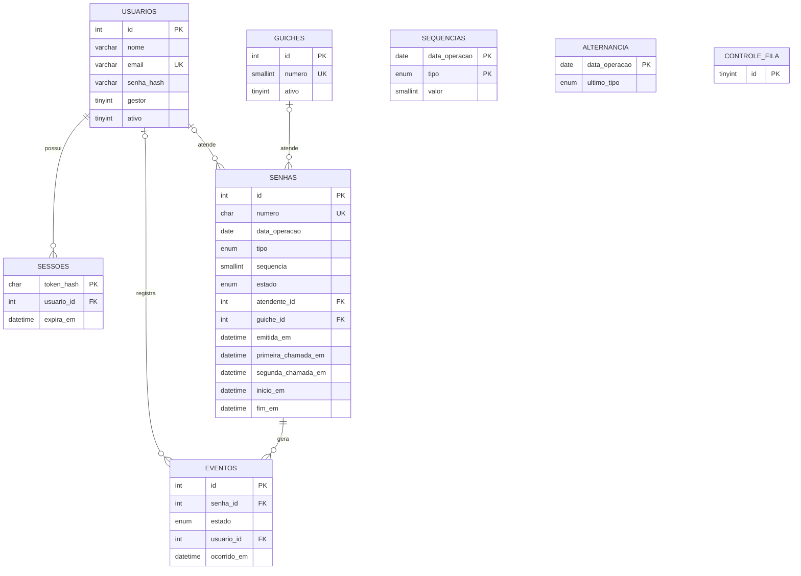

# Modelo entidade-relacionamento

O script executável está em [`schema.sql`](schema.sql). As entidades abaixo representam as tabelas existentes no MySQL.

`sequencias` permite reiniciar a numeração diariamente por tipo de senha. `alternancia` registra a última prioridade chamada. `controle_fila` possui uma única linha usada para serializar as operações concorrentes de emissão/chamada. O histórico de estados fica em `eventos`.

O tipo do último atendimento não prioritário é apurado a partir de `senhas` no momento da escolha, garantindo oportunidades para SG e SE sem mudar a estrutura já instalada.
