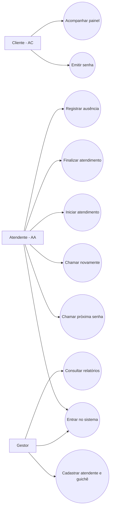

# Casos de uso

## Relação entre atores e operações

## UC01 — Emitir senha

**Ator:** Cliente. **Pré-condição:** dentro do expediente (ou demonstração declarada). **Fluxo:** escolher SP, SE ou SG no totem; sistema valida tipo/horário, gera número diário e coloca a senha aguardando. **Pós-condição:** registro persistido no banco. **Exceções:** sistema indisponível, horário encerrado ou sequência acima de 999.

## UC02 — Chamar próxima senha

**Ator:** Atendente autenticado. **Pré-condição:** guichê ativo e sem atendimento em andamento. **Fluxo:** escolher guichê; sistema bloqueia a operação concorrente, seleciona a próxima senha pela regra de alternância e a vincula ao guichê/atendente. **Pós-condição:** painel passa a mostrar a senha. **Exceções:** fila vazia, sessão inválida, guichê ocupado ou expediente encerrado.

## UC03 — Conduzir atendimento

**Ator:** Atendente autenticado. **Pré-condição:** senha chamada para o atendente. **Fluxo:** iniciar atendimento após comparecimento, finalizar após o serviço; ou chamar novamente e registrar ausência quando o cliente não comparecer. **Pós-condição:** estado, horários e eventos gravados. **Exceções:** transição inválida ou tentativa de atuar em senha de outro atendente.

## UC04 — Gerenciar equipe e relatórios

**Ator:** Gestor. **Pré-condição:** sessão válida com perfil de gestor. **Fluxo:** cadastrar atendente/guichê e consultar relatórios diários ou mensais. **Pós-condição:** cadastros e consultas realizados. **Exceções:** cadastro duplicado, permissão insuficiente ou falha de API.
