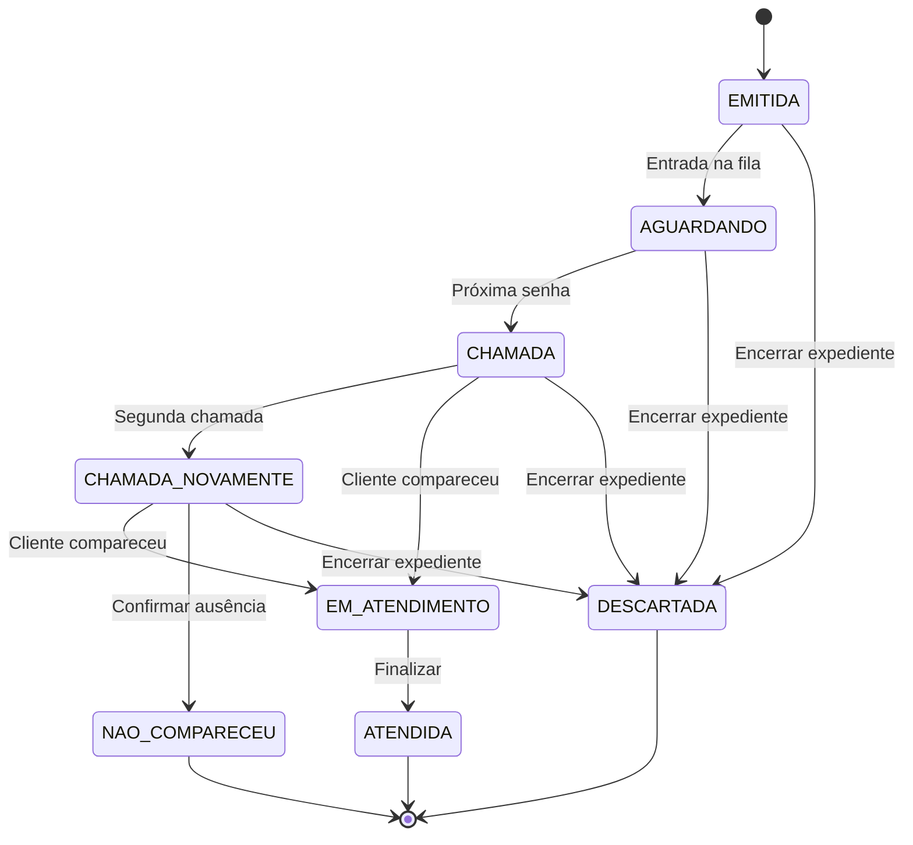
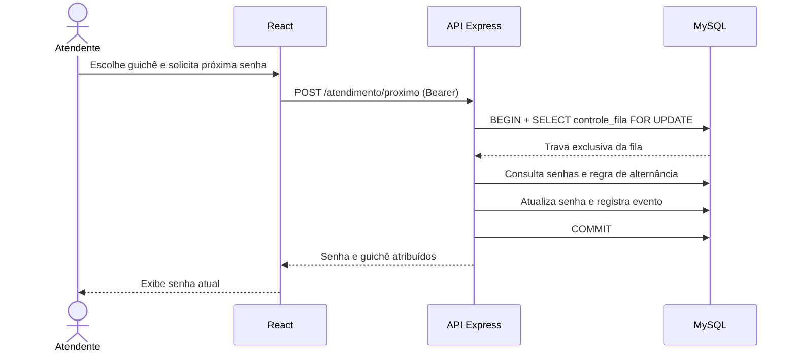
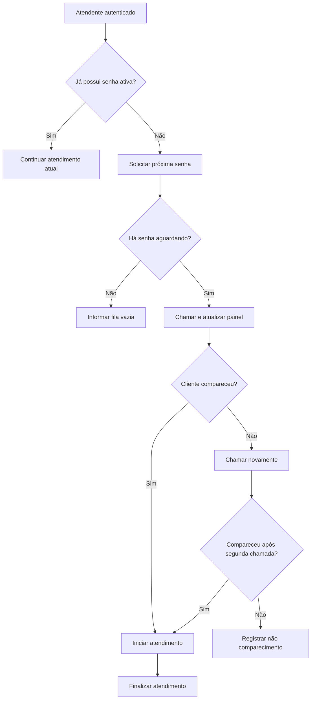

# Diagramas de comportamento

## Máquina de estados da senha

`DESCARTADA` é um estado administrativo adicional utilizado no fechamento do expediente.

## Sequência: atendimento com chamadas concorrentes

## Fluxo da operação

